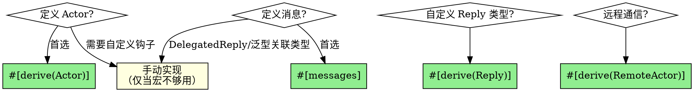

# Kameo Actor Framework (v0.21)

基于 Tokio 的容错异步 Actor 框架。用 Actor 模型替代锁（Mutex/RwLock），实现无死锁的并发状态管理。

## 核心原则

**优先使用宏语法消除样板代码，手动实现仅作后备。**

kameo 提供 5 个宏，覆盖 Actor 定义、消息定义、Reply 类型和远程通信。凡是宏能完成的，**禁止手写等价的样板代码**。



仅在以下情况才手动实现：
- `Actor` trait：需要异步初始化、自定义 `type Args`、`on_stop`/`on_panic`/`on_link_died` 钩子
- `Message<Msg>` trait：需要 `DelegatedReply`/`ForwardedReply`，或泛型 Actor 使用关联类型参数（如 `B::Message`）

## 核心概念

| 概念 | 说明 |
|------|------|
| `Actor` | 封装状态行为的异步单元，实现 `Actor` trait |
| `Message` | Actor 间通信载体，实现 `Message<Msg>` trait |
| `Reply` | 消息回复类型，已为标准库类型实现 |
| `ActorRef` | Actor 引用，用于发送消息和管理生命周期 |
| Mailbox | 消息队列，bounded（背压）或 unbounded |

## 依赖配置

```bash
cargo add kameo
# 默认启用 macros 和 tracing feature
```

## 宏一：#[derive(Actor)]

自动生成 `type Args = Self`、`type Error = Infallible`、`on_start` 透传。支持泛型。

### 宏 vs 手写对比

```rust
// ✅ 宏版本（1 行）
#[derive(Actor)]
pub struct Counter { count: i64 }

// ❌ 等价手写版本（9 行样板，禁止使用）
impl Actor for Counter {
    type Args = Self;
    type Error = Infallible;
    async fn on_start(args: Self::Args, _actor_ref: ActorRef<Self>) -> Result<Self, Self::Error> {
        Ok(args)
    }
}
```

### `#[actor]` 属性

| 属性 | 说明 | 示例 |
|------|------|------|
| `name` | 自定义名称（日志/调试） | `#[actor(name = "user_session")]` |
| `mailbox` | 邮箱类型 | `#[actor(mailbox = bounded)]` |

```rust
#[derive(Actor)]
#[actor(name = "user_session", mailbox = bounded)]
pub struct UserSession { user_id: Uuid }
```

### 后备：手动实现 Actor

仅在以下情况：

| 场景 | 原因 |
|------|------|
| 异步初始化 | `on_start` 需要网络/文件等异步操作 |
| 不同 Args 类型 | `type Args = Config` 而非 `Self` |
| 资源清理 | 需要 `on_stop` |
| panic 恢复 | 需要 `on_panic` 返回 `Continue` |
| 监督子 Actor | 需要 `on_link_died` |

#### 异步初始化 + 资源清理

```rust
impl Actor for DatabaseActor {
    type Args = DbConfig;
    type Error = DbError;

    async fn on_start(config: Self::Args, _actor_ref: ActorRef<Self>) -> Result<Self, Self::Error> {
        let pool = DbPool::connect(&config.url, config.max_conn).await?;
        Ok(Self { pool })
    }

    async fn on_stop(
        &mut self, _actor_ref: WeakActorRef<Self>, _reason: ActorStopReason,
    ) -> Result<(), Self::Error> {
        self.pool.close().await;
        Ok(())
    }
}
```

#### 错误恢复（on_panic）

```rust
async fn on_panic(
    &mut self, _: WeakActorRef<Self>, err: PanicError,
) -> Result<ControlFlow<ActorStopReason>, Self::Error> {
    self.reset_state();
    Ok(ControlFlow::Continue(()))
}
```

#### 监督关联（on_link_died）

```rust
async fn on_link_died(
    &mut self, actor_ref: WeakActorRef<Self>, _id: ActorId, _reason: ActorStopReason,
) -> Result<ControlFlow<ActorStopReason>, Self::Error> {
    if let Some(actor_ref) = actor_ref.upgrade() {
        self.child = WorkerActor::spawn_link(&actor_ref, WorkerActor).await;
    }
    Ok(ControlFlow::Continue(()))
}
```

### 生命周期钩子速查

| 钩子 | 默认行为 | derive 生成 |
|------|----------|-------------|
| `on_start` | — | 透传 `Ok(state)` |
| `on_stop` | 无操作 | 未生成 |
| `on_panic` | 停止 Actor | 未生成 |
| `on_link_died` | 非 Normal 则停止 | 未生成 |

### ActorStopReason 变体

| 变体 | 含义 |
|------|------|
| `Normal` | 优雅停止 |
| `Killed` | 强制终止 |
| `Panicked(PanicError)` | panic 导致停止 |
| `LinkDied { id, reason }` | 关联 Actor 死亡 |
| `SupervisorRestart` | 监督者重启 |

## 宏二：#[messages]

自动生成消息结构体并实现 `Message<Msg>` trait。一个 `impl` 块定义所有消息。

### 宏 vs 手写对比

```rust
// ✅ 宏版本（简洁，一个 impl 块搞定）
#[messages]
impl Counter {
    #[message(derive(Clone))]
    fn inc(&mut self, amount: u32) -> i64 {
        self.count += amount as i64;
        self.count
    }

    #[message]
    fn force_err(&self) -> Result<(), i32> { Err(3) }

    #[message(ctx)]
    fn shutdown(&self, ctx: &mut Context<Self, ()>) { ctx.stop() }
}

// ❌ 等价手写版本（每个消息 ~10 行样板，禁止使用）
pub struct Inc { pub amount: u32 }
impl Message<Inc> for Counter {
    type Reply = i64;
    async fn handle(&mut self, msg: Inc, _ctx: &mut Context<Self, Self::Reply>) -> Self::Reply {
        self.count += msg.amount as i64;
        self.count
    }
}
pub struct ForceErr;
impl Message<ForceErr> for Counter {
    type Reply = Result<(), i32>;
    async fn handle(&mut self, _msg: ForceErr, _ctx: &mut Context<Self, Self::Reply>) -> Self::Reply {
        Err(3)
    }
}
pub struct Shutdown;
impl Message<Shutdown> for Counter {
    type Reply = ();
    async fn handle(&mut self, _msg: Shutdown, ctx: &mut Context<Self, Self::Reply>) -> Self::Reply {
        ctx.stop()
    }
}
```

### `#[message]` 属性

| 属性 | 说明 | 示例 |
|------|------|------|
| 无 | 基本消息 | `#[message]` |
| `derive(...)` | 为生成的结构体派生 trait | `#[message(derive(Clone, Debug))]` |
| `ctx` | 包含 Context 参数 | `#[message(ctx)]` |
| `ctx = name` | Context 参数使用自定义名称 | `#[message(ctx = my_ctx)]` |

### 后备：手动实现 Message<Msg>

仅在以下情况：
- **外部消息类型**：消息结构体定义在其他 crate（如 `NotifyChange<M>`），`#[messages]` 只能生成新结构体，无法为已有外部类型实现 `Message`
- 需要 `DelegatedReply`（异步委托回复）
- 需要 `ForwardedReply`（转发给其他 Actor）
- 泛型 Actor + 关联类型参数（如 `B::Message`）——`#[messages]` 不会为关联类型提取泛型参数

```rust
// 外部消息类型示例：agent-context 定义的 NotifyChange，App 需要接收
impl Message<NotifyChange<ProviderMessage>> for App {
    type Reply = ();
    async fn handle(&mut self, msg: NotifyChange<ProviderMessage>, _ctx: &mut Context<Self, Self::Reply>) {
        // 处理变更通知
    }
}

// 自定义消息示例
pub struct Increment { pub amount: u32 }

impl Message<Increment> for Counter {
    type Reply = i64;
    async fn handle(&mut self, msg: Increment, _ctx: &mut Context<Self, Self::Reply>) -> Self::Reply {
        self.count += msg.amount as i64;
        self.count
    }
}
```

## 宏三：#[derive(Reply)]

让自定义 struct 实现 Reply trait（标记为 infallible），使其可直接作为 `Message::Reply` 类型。

### 宏 vs 手写对比

```rust
// ✅ 宏版本（1 行）
#[derive(kameo::Reply)]
pub struct UserProfile { name: String, age: u32 }

// ❌ 等价手写版本（13 行样板，禁止使用）
impl kameo::Reply for UserProfile {
    type Ok = Self;
    type Error = std::convert::Infallible;
    type Value = Self;
    fn to_result(self) -> Result<Self::Ok, Self::Error> { Ok(self) }
    fn into_any_err(self) -> Option<Box<dyn kameo::reply::ReplyError>> { None }
    fn into_value(self) -> Self::Value { self }
}
```

### 使用

```rust
impl Message<GetProfile> for UserActor {
    type Reply = UserProfile;  // 直接返回，无需包 Result
    async fn handle(&mut self, _msg: GetProfile, _ctx: &mut Context<Self, Self::Reply>) -> Self::Reply {
        self.profile.clone()
    }
}
```

`Reply` 已为标准库类型内置实现：所有原语、String、Option、Result、元组（最多12元素）、数组。只有自定义 struct 才需要 derive。

### Reply 类型选择

| Reply 类型 | 场景 |
|------------|------|
| `()` | 无需回复（tell 场景） |
| `i64`, `String` 等 | 直接返回值 |
| `Result<T, E>` | 可能失败的操作 |
| 自定义 struct + `#[derive(Reply)]` | 返回结构化数据 |
| `DelegatedReply<T>` | 异步委托回复（需 `ctx.reply_sender()`） |
| `ForwardedReply<M, R>` | 转发给其他 Actor |

## 宏四和五：远程通信（remote feature）

需要 `remote` feature，用于分布式 Actor 通信。

```rust
#[derive(RemoteActor)]
#[remote_actor(id = "my_actor")]  // 可选，不指定则用 module_path + 类型名
pub struct MyActor { }

#[remote_message]  // 或 #[remote_message("custom_id")]
impl Message<MyMessage> for MyActor { ... }
```

## 宏速查

| 宏 | 类型 | 消除的样板 | Feature |
|------|------|------|---------|
| `#[derive(Actor)]` | derive | Actor trait 的 Args/Error/on_start | 默认 |
| `#[messages]` | attribute | 消息结构体定义 + Message trait impl | 默认 |
| `#[derive(Reply)]` | derive | Reply trait 的 Ok/Error/Value/to_result | 默认 |
| `#[derive(RemoteActor)]` | derive | RemoteActor trait + 注册 | `remote` |
| `#[remote_message]` | attribute | RemoteMessage trait + 注册 | `remote` |

## 邮箱配置

```rust
use kameo::mailbox;

// bounded：固定容量，背压控制
let actor_ref = MyActor::spawn_with_mailbox(actor, mailbox::bounded(1000));

// unbounded：无限容量，无背压
let actor_ref = MyActor::spawn_with_mailbox(actor, mailbox::unbounded());
```

也可通过 `#[actor]` 属性指定：`#[actor(mailbox = bounded)]`。

## 启动 Actor

>`spawn` 传入的是 **Actor struct 的实例**：`ActorStruct::spawn(ActorStruct { field: val, .. })`。
>实例对应的类型是 `Actor::Args`——`#[derive(Actor)]` 时 `Args = Self` 即 struct 自身；
>手动 `impl Actor` 可改 `Args`（如元组），此时实例形态随之变化。
>`spawn` 由 `use kameo::prelude::*` 引入，**不是** `kameo::spawn()`。

```rust
use kameo::prelude::*;

// 基本启动（默认 bounded 邮箱，容量 64）
let actor_ref = MyActor::spawn(MyActor { count: 0 });

// 自定义邮箱
let actor_ref = MyActor::spawn_with_mailbox(MyActor { count: 0 }, mailbox::bounded(1000));

// 阻塞操作用独立线程
let actor_ref = MyActor::spawn_in_thread(MyActor { count: 0 });

// 关联启动（父子关联，子死亡通知父）
let child_ref = WorkerActor::spawn_link(&parent_ref, WorkerActor).await;

// 预准备（spawn 前获取 ActorRef，用于先 link 再启动）
let prepared = MyActor::prepare();
prepared.actor_ref().link(&other_ref).await;
let actor_ref = prepared.spawn(MyActor::default());
```

### 监督启动

```rust
let actor_ref = WorkerActor::supervise(&supervisor_ref, WorkerActor)
    .restart_policy(RestartPolicy::Permanent)
    .restart_limit(3, Duration::from_secs(60))
    .spawn();
```

| RestartPolicy | 行为 |
|---------------|------|
| `Permanent` | 总是重启 |
| `Transient` | 仅异常退出时重启 |
| `Never` | 从不重启 |

## 消息通信

### Ask（请求-响应）

```rust
// 基本用法
let count: i64 = actor_ref.ask(Increment { amount: 3 }).await?;

// 带超时
let result = actor_ref
    .ask(Query {})
    .mailbox_timeout(Duration::from_millis(100))
    .reply_timeout(Duration::from_secs(5))
    .send()
    .await?;

// 非阻塞
let result = actor_ref.ask(Query {}).try_send().await?;

// 同步上下文
let result = actor_ref.ask(Query {}).blocking_send()?;
```

### Tell（即发即忘）

```rust
actor_ref.tell(Notify { msg: "hello".into() }).await?;
// 注意：tell 消息的 handler 返回 Err 会导致 Actor panic，默认停止
```

### Ask vs Tell 选择

| 场景 | 模式 | 原因 |
|------|------|------|
| 查询状态 | ask | 需要返回值 |
| 可能失败的操作 | ask | 需要处理错误 |
| 通知/事件 | tell | 不需要回复 |
| Actor 自身发消息 | tell | ask 自身会死锁 |

## ActorRef 完整 API

### 生命周期

```rust
actor_ref.stop_gracefully().await?;
actor_ref.kill();
actor_ref.is_alive();
actor_ref.wait_for_shutdown().await;
```

### 关联

```rust
actor_ref_a.link(&actor_ref_b).await;
actor_ref_a.unlink(&actor_ref_b).await;
actor_ref_a.blocking_link(&actor_ref_b);
```

### 引用管理

```rust
let weak = actor_ref.downgrade();
let strong = weak.upgrade();       // Option<ActorRef>
actor_ref.strong_count();
actor_ref.weak_count();
```

### 全局注册表

```rust
actor_ref.register("my_actor")?;
let found: Option<ActorRef<MyActor>> = ActorRef::lookup("my_actor")?;
```

### 类型擦除：Recipient 与 ReplyRecipient

`ActorRef<A>` 携带具体 Actor 类型 `A`，当函数需要接受"能处理某种消息的任意 Actor"时，无法直接使用。kameo 通过 trait object 擦除具体 Actor 类型，提供两种擦除引用：

#### Recipient\<M\> — 单向（仅 tell）

```rust
pub struct Recipient<M: Send + 'static> {
    pub(crate) handler: Box<dyn MessageHandler<M>>,
}
```

- 泛型参数只有消息类型 `M`，**Actor 类型 `A` 被擦除**
- 通过 `actor_ref.recipient::<M>()` 创建，约束 `A: Message<M>`
- 只支持 `tell`（即发即忘）

#### ReplyRecipient\<M, Ok, Err\> — 双向（tell + ask）

"双向"（bidirectional）是 kameo 官方术语，指调用者既能向 Actor 发送消息（tell），也能收到 Actor 的回复（ask）。消息流向：调用者 → Actor → 调用者，有去有回。

```rust
pub struct ReplyRecipient<M: Send + 'static, Ok: Send + 'static, Err: ReplyError = Infallible> {
    pub(crate) handler: Box<dyn ReplyMessageHandler<M, Ok, Err>>,
}
```

- 泛型参数是 `M`（消息）、`Ok`（成功类型）、`Err`（错误类型），**Actor 类型 `A` 同样被擦除**
- 通过 `actor_ref.reply_recipient::<M>()` 创建，`Ok`/`Err` 从 `Message::Reply` 的关联类型推导
- 支持 `tell` + `ask`（请求-响应）
- 可通过 `.erase_reply()` 降级为 `Recipient<M>`

#### 擦除原理

两个 crate-private trait 实现擦除：

- `MessageHandler<M>` — 为 `ActorRef<A>` 实现（当 `A: Actor + Message<M>`），把 `ActorRef<A>` 的方法装箱为 `BoxFuture`
- `ReplyMessageHandler<M, Ok, Err>` — 扩展 `MessageHandler`，增加 `ask` 方法

创建时 `Box::new(actor_ref)` 把 `ActorRef<A>` 转为 `Box<dyn MessageHandler<M>>`，调用者只知道"这个引用能处理消息 M"，不再知道背后是哪个具体的 Actor。

#### 使用示例

**Recipient — 单向通知：**

```rust
fn notify_all(recipients: &[Recipient<Notify>], msg: Notify) {
    for r in recipients {
        let _ = r.tell(msg.clone()).await;
    }
}

let r1: Recipient<Notify> = actor_ref_a.recipient();
let r2: Recipient<Notify> = actor_ref_b.recipient();
notify_all(&[r1, r2], Notify { text: "hello" });
```

**ReplyRecipient — 双向请求-响应：**

```rust
async fn query_first(responders: &[ReplyRecipient<Query, Data, QueryError>], q: Query) -> Option<Data> {
    for r in responders {
        if let Ok(data) = r.ask(q.clone()).send().await {
            return Some(data);
        }
    }
    None
}

let r1: ReplyRecipient<Query, Data, QueryError> = cache_actor_ref.reply_recipient();
let r2: ReplyRecipient<Query, Data, QueryError> = db_actor_ref.reply_recipient();
let data = query_first(&[r1, r2], Query { key: "user:42" }).await;
```

**erase_reply — 降级为 Recipient：**

```rust
let reply_r: ReplyRecipient<Query, Data, QueryError> = actor_ref.reply_recipient();
let tell_only: Recipient<Query> = reply_r.erase_reply();
```

#### 弱引用变体

| 类型 | 说明 |
|------|------|
| `WeakRecipient<M>` | `Recipient` 的弱引用，不阻止 Actor 停止 |
| `WeakReplyRecipient<M, Ok, Err>` | `ReplyRecipient` 的弱引用，不阻止 Actor 停止 |

通过 `.downgrade()` 获取，通过 `.upgrade()` 尝试恢复为强引用。

#### 类型擦除选择

| 场景 | 使用 | 原因 |
|------|------|------|
| 只需发送通知 | `Recipient<M>` | 不需要回复，API 更简单 |
| 需要请求-响应 | `ReplyRecipient<M, Ok, Err>` | 保留 ask 能力 |
| 存储多种 Actor 的引用 | `Recipient<M>` | 同一消息类型，不同 Actor 类型可共存 |
| 避免阻止 Actor 停止 | `WeakRecipient<M>` / `WeakReplyRecipient<M, Ok, Err>` | 不计入 RAII 引用计数 |

### 流附加

```rust
actor_ref.attach_stream(source_stream).await?;
```

## Context 方法

在 `Message::handle` 中通过 `ctx` 访问：

```rust
ctx.actor_ref()          // 获取当前 ActorRef
ctx.stop()               // 信号停止
ctx.reply_sender()       // DelegatedReply 的回复发送器
ctx.reply(value)         // 直接回复
ctx.spawn(child)         // 在 handler 中启动子 Actor
ctx.forward(target, msg) // 转发消息到其他 Actor
```

## 监督与关联

| 方式 | 说明 |
|------|------|
| `spawn_link(&parent, args)` | 启动并关联（推荐） |
| `actor_ref.link(&other)` | 手动关联已有 Actor |
| `supervise(&supervisor, args)` | 启动带自动重启 |

监督策略（`Actor::supervision_strategy`）：

| 策略 | 行为 |
|------|------|
| `OneForOne` | 仅重启失败的子 Actor（默认） |
| `OneForAll` | 任一子失败，重启所有子 |
| `RestForOne` | 重启失败子及其后面的兄弟 |

## 错误处理

| 发送方式 | Handler 返回 Err 的后果 |
|----------|------------------------|
| `ask` | 错误通过 `SendError::HandlerError` 返回给调用者 |
| `tell` | 视为 Actor panic，触发 `on_panic` 钩子，默认停止 Actor |

`SendError` 变体：

- `ActorNotRunning(M)` — Actor 未运行
- `ActorStopped` — Actor 处理期间停止
- `MailboxFull(M)` — 邮箱已满
- `HandlerError(E)` — Handler 返回错误
- `Timeout(Option<M>)` — 超时

`SendError` 方法：`map_msg()`、`map_err()`、`msg()`、`err()`、`boxed()`。

### SendError 作为 std::error::Error

`SendError<M, E>` 实现了 `std::error::Error`，可直接 `?` 传播进 `anyhow::Error`/`Box<dyn Error>` 等。但有两个**契约性约束**：

1. **`E` 必须实现 `std::error::Error + 'static`**（不仅是 `Display`）。即 handler 错误类型本身得是个标准错误，自定义错误应派生 `thiserror::Error` 或手动实现 `std::error::Error`，而非只用 `Display`。否则在需要 `SendError: Error` 的场景编译失败。
2. **`HandlerError` 变体支持错误链溯源**：`SendError::source()` 在该变体上返回 `Some(&E)`，调试时可沿 `.source()` 链一路追到根因。其他变体返回 `None`。

`PanicError` 包含 `PanicReason`：

| 原因 | 场景 |
|------|------|
| `HandlerPanic` | 消息 handler panic |
| `OnMessage` | `on_message` 钩子返回错误（tell 时 handler 返 Err 即归此） |
| `OnStart` / `OnStop` / `OnPanic` / `OnLinkDied` | 生命周期钩子 panic/返错 |
| `Next` | `Actor::next` 返回错误 |

判断宏辅助：`PanicReason::is_lifecycle_hook()` / `is_message_processing()`。

## 常见错误

| 错误 | 原因 | 解决 |
|------|------|------|
| Actor 自身 ask 死锁 | Actor 顺序处理消息 | 用 tell 代替 |
| tell 后 Actor 消失 | Handler 返回 Err | 用 ask 捕获错误 |
| 邮箱满 | bounded 容量不足 | 增大容量或用 unbounded |
| 状态丢失 | Actor panic 后默认停止 | 实现 `on_panic` 恢复逻辑 |
| 关联 Actor 全部停止 | 默认 link_died 行为 | 实现 `on_link_died` 返回 `Continue` |
| ask 返回类型不对 | kameo 自动展开 `Result` Reply | 注意 `ask().await` 直接返回内层类型 |
| `SendError: Error` 编译失败 | handler 错误类型 `E` 只实现了 `Display` | 让 `E` 实现 `std::error::Error + 'static`（如 `thiserror::Error`） |

## 运行时监控（console feature）

启用 `console` feature 后，每个 actor 自动挂载轻量监控（计数器、状态、邮箱深度），通过 TCP 暴露给 `kameo_console` 客户端做实时 TUI 查看监督树、吞吐、背压、重启。

```rust
// 应用进程内：暴露快照
let _handle = kameo::console::serve("127.0.0.1:9999").await?;

// 另一终端：连接并查看
// cargo run -p kameo_console
```

需要自定义暴露方式时用 builder：`Console::new()` 构造后 `.serve(addr)`。日常监控用 `serve` 即可，监控数据自动采集，无需在业务代码里埋点。
